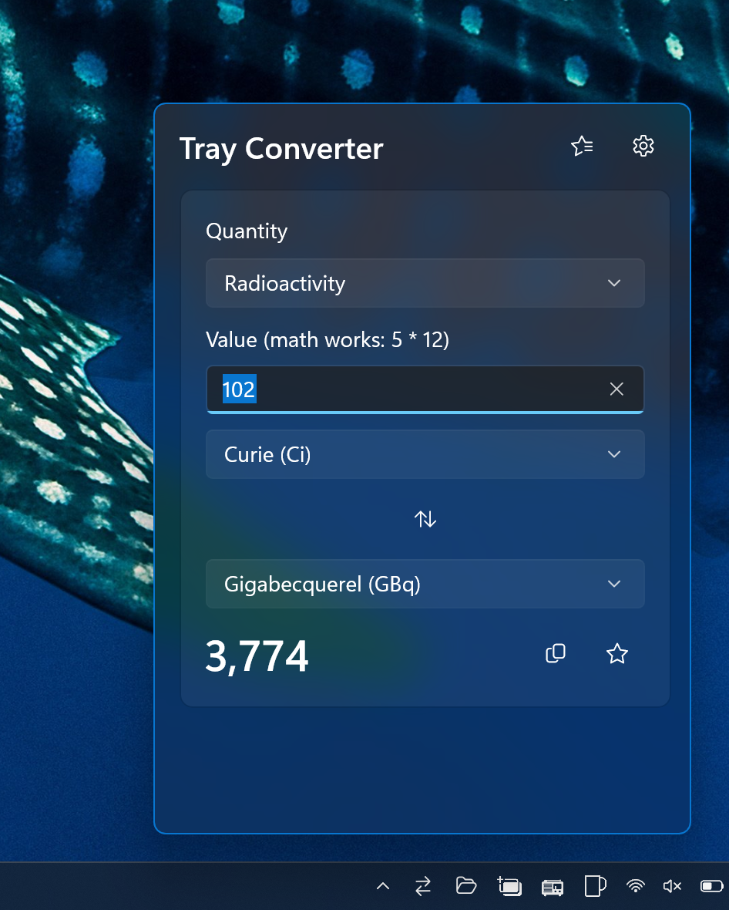

# Tray Converter

A unit converter that lives in the Windows system tray. Click the icon, type a value, and copy the result. There's no main window and nothing running in the background beyond the icon.

Built with WinUI 3 and the Windows App SDK.

<p align="center">
  
</p>

## Features

- **Around 100 quantities.** Length, mass, temperature, volume, speed, pressure, energy, data size, and everything else [UnitsNet](https://github.com/angularsen/UnitsNet) knows about.
- **Math in the value box.** Type `5 * 12` or `sqrt(2)` and it's evaluated with [NCalc](https://github.com/ncalc/ncalc) before converting.
- **Sensible defaults.** Common quantities open on everyday pairs, such as meters to feet, Celsius to Fahrenheit, and liters to US gallons. The app remembers your last quantity and units.
- **One-click copy and swap.** Flip the two units or copy the result to the clipboard.
- **Favorites.** Star a conversion and get back to it from the header dropdown. Manage them in settings.
- **Result precision.** Automatic (6 significant figures), a fixed number of decimal places, or a fixed number of significant figures.
- **Thousands separators.** Choose whether copied results keep them. The on-screen result always shows them.
- **Start with Windows.** Optional.
- **Light on memory.** The flyout is hidden on dismiss and closed after a minute, and the unit catalog is released when idle.

## Requirements

- Windows 10 version 1809 (10.0.17763) or later
- x64 or ARM64
- To build: the [.NET 10 SDK](https://dotnet.microsoft.com/download) and Windows Developer Mode turned on

## Getting started

```powershell
git clone https://github.com/Tray-Land/tray-converter.git
cd tray-converter
dotnet run
```

The project references `Microsoft.Windows.SDK.BuildTools.WinApp`, so `dotnet run` registers a loose-layout package with the [`winapp` CLI](https://github.com/microsoft/WinAppCli) and launches the app with package identity. Look for the icon in the notification area. Right-click it for **Open**, **Settings**, and **Exit**.

To test first-run behavior, wipe the app's local state with `winapp run <build-output> --clean`.

### Build

```powershell
$Platform = if ($env:PROCESSOR_ARCHITECTURE -eq 'AMD64') { 'x64' } else { $env:PROCESSOR_ARCHITECTURE }
dotnet build -c Debug -p:Platform=$Platform
```

### Package a release

`build-msix-for-gh.ps1` builds and signs an MSIX and publishes it as a GitHub release. It needs an authenticated [`gh`](https://cli.github.com/) CLI. Pass `-SkipRelease` to build and sign without tagging.

```powershell
./build-msix-for-gh.ps1 -SkipRelease
```

## Project layout

| Path | Contents |
|---|---|
| `App.xaml.cs` | Tray icon, single-instance handling, and the Exit menu (the only way the app closes) |
| `Views/` | The flyout window, the converter page, and the settings page |
| `Services/ConversionService.cs` | Unit catalog, input evaluation, and result formatting, with no WinRT dependency |
| `Services/` | Settings, favorites, startup registration, theme, and window placement |
| `branding/` | Source SVGs for the app icon |

## Built with

- [Windows App SDK](https://learn.microsoft.com/windows/apps/windows-app-sdk/) and WinUI 3
- [UnitsNet](https://github.com/angularsen/UnitsNet)
- [NCalc](https://github.com/ncalc/ncalc)
- [WinUIEx](https://github.com/dotMorten/WinUIEx)

## License

[MIT](LICENSE) © 2026 Joseph Finney
